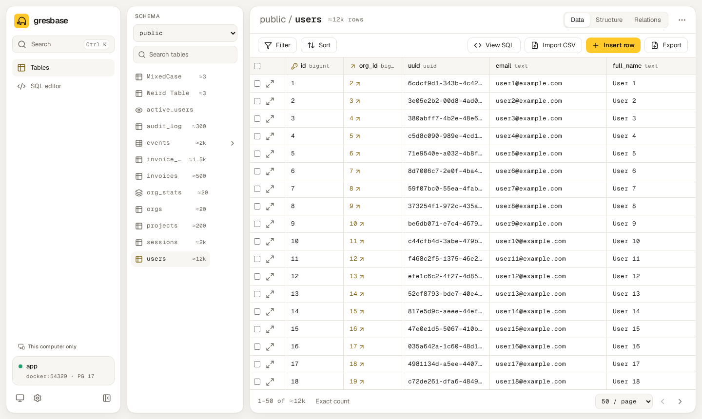
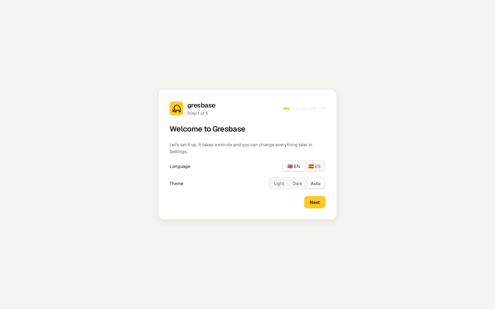
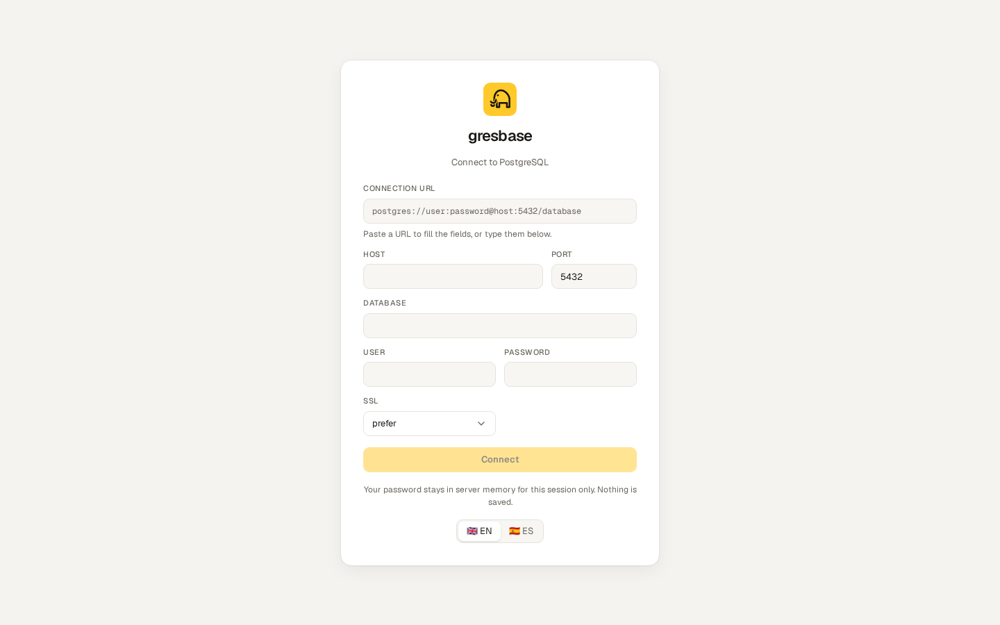
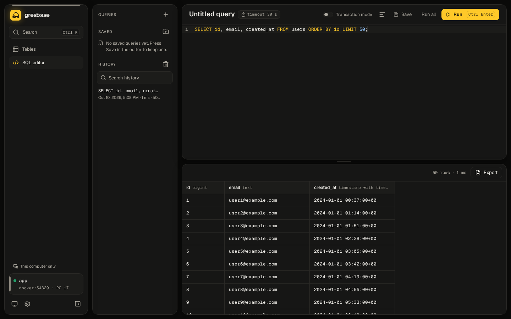
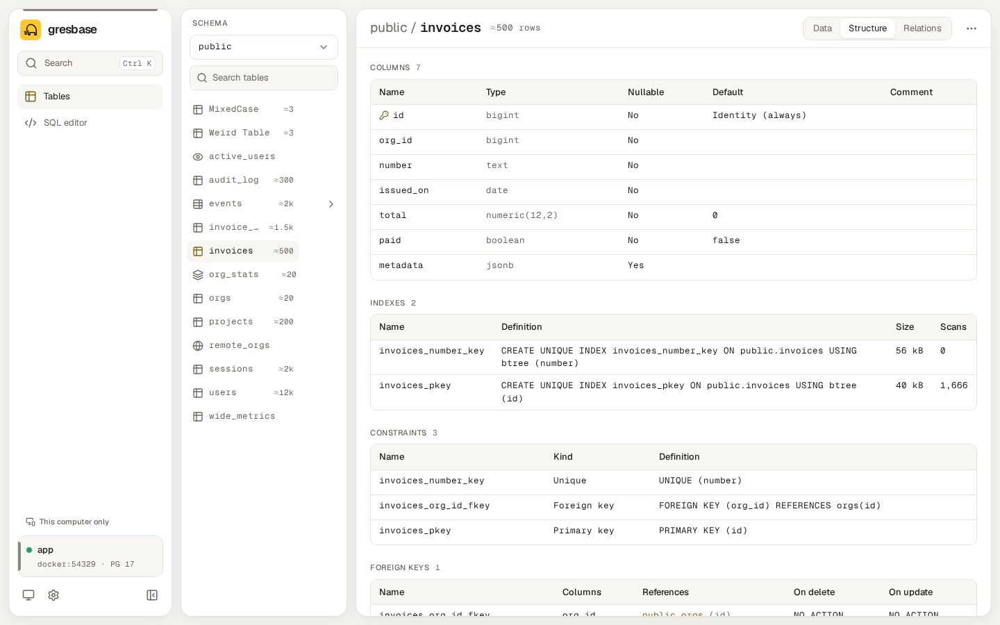
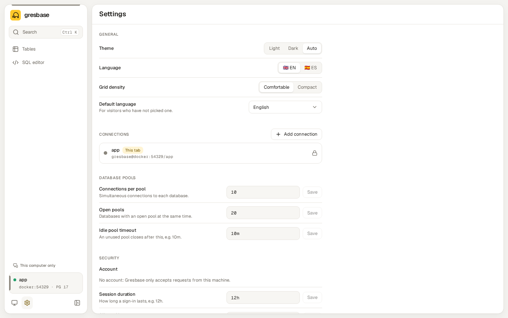
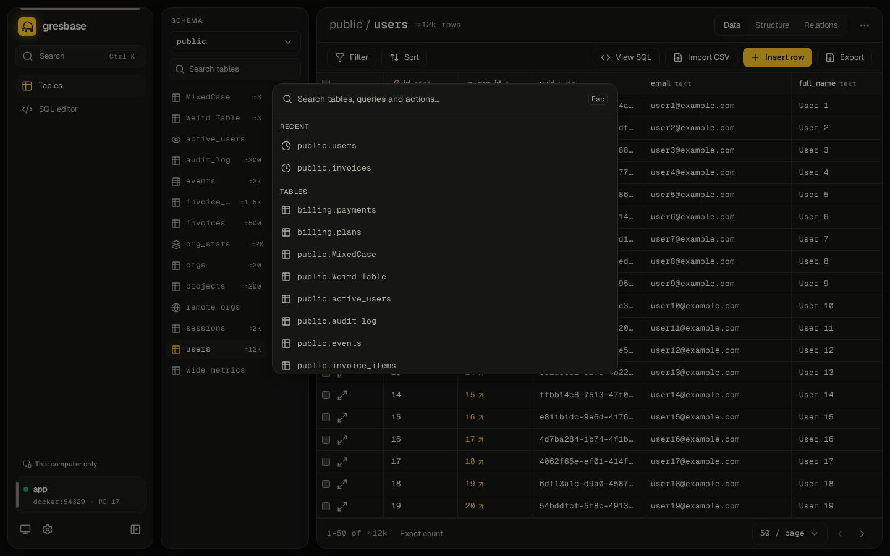

# gresbase

The studio for any Postgres. Add one container to your `docker-compose` and get a fast, modern UI to
browse tables, edit data and structure safely and run SQL — a replacement for Adminer or pgAdmin in your
own projects. Zero mandatory variables: configure it with environment variables or from the setup wizard.



## Try it in one command

A demo with a sample database, using the published image. You only need Docker:

```bash
curl -fsSLO https://raw.githubusercontent.com/amtzespinosa/gresbase/main/deploy/docker-compose.demo.yml
docker compose -f docker-compose.demo.yml up -d
```

Open <http://localhost:8080>. The file starts PostgreSQL with sample data and five Gresbase instances,
one per way of using it (8080 to 8084, described at the top of the file).
`docker compose -f docker-compose.demo.yml down -v` removes everything.

- **Tables:** schema picker, search, favorites, recents and tabs, virtualized grid, filters and
  multi-column sort in the URL, keyset pagination, hide/reorder/resize/pin columns, pin rows, relations
  and foreign key jumps.
- **Safe editing:** inline editors per type, copy and paste from a spreadsheet (TSV/CSV), a queue of
  pending changes with a diff and the SQL, one transaction per save, undo and redo (also after saving),
  conflict detection, and confirmations that match the risk.
- **Structure editing:** create tables; add, rename, retype and drop columns; indexes (including
  partial and `CONCURRENTLY`), unique and check constraints and foreign keys (with `NOT VALID` and
  validate). Every change shows the exact SQL and its warnings (locks, rewrites) before it runs.
- **SQL editor:** tabs per connection, CodeMirror with autocomplete, `:name` parameters sent as bound
  parameters, run the statement under the cursor or all of them, cancel, transaction mode, history and
  saved queries (per connection or shared).
- **Connections:** one from `DATABASE_URL`, saved connections with a color label and a selector (each
  browser tab can work on a different one), or free mode like Adminer.
- **The rest:** setup wizard, settings screen, ⌘K command palette, CSV import/export, light/dark
  themes, English and Spanish, optional login, read-only mode. One small image, no telemetry, works offline.

| Postgres | Support |
| --- | --- |
| 14, 15, 16, 17, 18 | Full, tested on every change |
| 19 | Full; tested against the latest beta/RC until it is released |
| 12, 13 | Legacy: tested on every change, a few features depend on the version, the UI shows a notice |
| 11 and older | Not supported: Gresbase explains it when connecting |

Details per version in [`docs/compatibility.md`](docs/compatibility.md) (Spanish).

The image is `ghcr.io/amtzespinosa/gresbase`, for `linux/amd64` and `linux/arm64`.

## Quick start

There are two ways to start: with environment variables, or with no configuration and the setup wizard.

### With environment variables

Add Gresbase next to your Postgres (full example in
[`deploy/docker-compose.example.yml`](deploy/docker-compose.example.yml)):

```yaml
services:
  db:
    image: postgres:17
    environment:
      POSTGRES_USER: app
      POSTGRES_PASSWORD: app
      POSTGRES_DB: app

  gresbase:
    image: ghcr.io/amtzespinosa/gresbase:0.3
    ports:
      - "127.0.0.1:8080:8080"
    environment:
      DATABASE_URL: postgres://app:app@db:5432/app?sslmode=disable
    volumes:
      - gresbase-data:/data   # settings, saved connections and saved queries survive recreation
    depends_on:
      - db

volumes:
  gresbase-data:
```

```bash
docker compose up -d
```

Open <http://localhost:8080>. Without `GRESBASE_USER`/`GRESBASE_PASSWORD` there is no login and
Gresbase only answers to `localhost` (see [Security](#security)).

### With the setup wizard

Leave out `DATABASE_URL` and keep the `/data` volume. Gresbase starts in setup mode and every page
leads to the wizard: language and theme, mode (saved connection or free mode), administrator account and
the first connection, with a "Test connection" button. Inside a container your browser is not on the same
machine as Gresbase, so the wizard asks for the setup token. Open the link in the `SETUP MODE` log line
(`/setup#token=…`) or print the token:

```bash
docker compose exec gresbase /gresbase setup-token
```

(or set `GRESBASE_SETUP_TOKEN` yourself). Everything is saved in `/data/gresbase.json`, connection
passwords encrypted; once finished, setup is closed for good. Without a persistent `/data` the wizard
warns that the configuration will be lost on restart.



### Saved connections

From **Settings → Connections** the administrator adds more databases: name, color label, host, port,
database, user, password (encrypted at rest and never sent back by the API), SSL and read-only. The
connection card and ⌘K switch between them, and the color shows which one you are on. The URL carries
the connection (`/c/<id>/…`), so two browser tabs can work on two databases at the same time. The
`DATABASE_URL` connection, if any, is listed with a lock.

### Free mode

`GRESBASE_MODE_FREE=true` (or "Free mode" in the wizard) turns the login screen into a Postgres login,
like Adminer: server, user and password, nothing saved on the server. **Set
`GRESBASE_ALLOWED_DB_HOSTS`** to the servers it may reach: otherwise anyone who can open the page can use
Gresbase to probe your network. See [Security](#security).



### Health and binaries

The image has a `HEALTHCHECK` (`gresbase healthcheck`); `/healthz` returns `503` when the database is
unreachable and `{"status":"setup"}` in setup mode. Release builds also produce standalone binaries for
Linux, macOS and Windows, attached to each [GitHub release](https://github.com/amtzespinosa/gresbase/releases).

## Screenshots

| | |
| --- | --- |
|  |  |
|  |  |

More, in light/dark and desktop/tablet, in [`docs/screenshots/`](docs/screenshots/).

## Configuration

| Variable | Default | What it does |
| --- | --- | --- |
| `DATABASE_URL` | empty | Postgres connection URL (respects `sslmode`). Optional: without it (and without saved connections) Gresbase opens the setup wizard |
| `GRESBASE_PORT` | `8080` | HTTP port |
| `GRESBASE_BASE_PATH` | `/` | Base path behind a reverse proxy (e.g. `/gresbase`) |
| `GRESBASE_USER` / `GRESBASE_PASSWORD` | empty | If both are set, login is enabled |
| `GRESBASE_SESSION_SECRET` | generated | Cookie signing key, at least 32 characters. If unset, a random one is generated and kept (encrypted) in `gresbase.json`, so sessions survive restarts when the data dir is persistent |
| `GRESBASE_SESSION_TTL` | `12h` | Session lifetime |
| `GRESBASE_ALLOWED_HOSTS` | empty | Extra `Host` names accepted without login (comma-separated) |
| `GRESBASE_TRUSTED_PROXIES` | empty | Reverse proxies (IPs or CIDRs, comma-separated) whose `X-Forwarded-For` gives the client IP for the sign-in limit |
| `GRESBASE_READ_ONLY` | `false` | Blocks every write |
| `GRESBASE_STATEMENT_TIMEOUT` | `30s` | Limit per query |
| `GRESBASE_IMPORT_TIMEOUT` | `10m` | Limit for a CSV import (replaces the query limit; canceled if the client disconnects) |
| `GRESBASE_SQL_MAX_ROWS` | `1000` | Default row limit of a SQL editor result (1–100000; applies without restart) |
| `GRESBASE_MAX_CONNS` | `10` | Maximum size of each pool |
| `GRESBASE_MAX_POOLS` | `20` | Maximum database pools open at once (one per connection in use) |
| `GRESBASE_POOL_IDLE_TIMEOUT` | `10m` | Close a connection's pool after this long unused (never the `DATABASE_URL` one) |
| `GRESBASE_DATA_DIR` | `/data` | Saved queries and settings (`gresbase.json`) |
| `GRESBASE_SECRET_KEY` | generated | Key (at least 32 characters) that encrypts the secrets stored in `gresbase.json`. If unset, `GRESBASE_DATA_DIR/secret.key` is generated |
| `GRESBASE_SETUP_TOKEN` | random, logged | Token the setup wizard asks for when the request does not come from this machine (at least 16 characters). If unset, a random one is printed in the logs |
| `GRESBASE_DB_HOST` / `GRESBASE_DB_PORT` | empty | Fix the server and port of the connection forms (setup wizard, free mode) |
| `GRESBASE_DB_NAME` / `GRESBASE_DB_USER` | empty | Fix the database and user of those forms; with host, database and user fixed, free mode only asks for the password |
| `GRESBASE_MODE_FREE` | `false` | Free mode, like Adminer: sign in with any Postgres user and password, nothing saved. Not combinable with `DATABASE_URL` or `GRESBASE_USER` |
| `GRESBASE_ALLOWED_DB_HOSTS` | empty | Servers free mode may connect to: host names, IPs or CIDRs (comma-separated). Empty allows any |
| `GRESBASE_MAX_SESSIONS` | `10` | Simultaneous free mode sessions (each gets a pool of 3 connections) |
| `GRESBASE_LANG` | `en` | Default language: `en` or `es` |
| `GRESBASE_LOG_LEVEL` | `info` | `debug`, `info`, `warn`, `error` |
| `GRESBASE_LOG_FORMAT` | `text` | `text` or `json` |

On startup Gresbase retries the connection for up to 30 seconds and explains the failure (DNS,
connection refused, credentials, SSL, missing database). Logs never contain credentials.

If `GRESBASE_DATA_DIR` is missing or not writable, saved queries are kept in a temporary directory
and the UI tells you how to mount a volume.

### Settings file

Every setting resolves in three layers: **environment variable > `GRESBASE_DATA_DIR/gresbase.json` >
default**. The file holds the settings changed from the app (language, session lifetime, allowed hosts,
read-only, timeouts, pool size) and is written atomically with mode `0600`. A setting defined by an
environment variable is locked: the app shows it but cannot change it. Port, base path, data dir,
logging and `DATABASE_URL` are environment-only.

Secrets stored in the file (such as the session key) are encrypted with AES-GCM. The key comes from
`GRESBASE_SECRET_KEY` or, if unset, from a generated `secret.key` next to the file. **Limitation:** if
the whole volume leaks, the generated key leaks with it. For stronger protection, set
`GRESBASE_SECRET_KEY` (for example from a Docker secret) so the key never touches the volume.

## Security

- **Setup wizard.** Without `DATABASE_URL` and without saved connections, Gresbase starts in setup mode:
  every route leads to the wizard and `/healthz` answers `{"status":"setup"}`. Requests from this machine
  (a loopback peer **and** a local `Host`) need nothing else; any other request, including a DNS-rebinding
  page in your own browser, needs the setup token printed in the logs at startup (or
  `GRESBASE_SETUP_TOKEN`). Inside a container, requests from the host are not loopback, so use the token:
  `docker compose exec gresbase /gresbase setup-token`, or the `/setup#token=…` link in the logs. Once completed, the setup endpoints are gone for good
  (until `gresbase.json` is deleted). Saved connection passwords are encrypted in `gresbase.json`.
- **Free mode.** With `GRESBASE_MODE_FREE=true` (or "Free mode" in the setup wizard) the login screen asks
  for a Postgres server, user and password: if Gresbase can connect, that is the session. The password
  lives only in server memory, in that session's connection, and is gone on sign out, expiry or restart;
  the browser keeps recent connections without passwords. Saved queries and server settings are off. A
  Gresbase in free mode reachable from a network can be used to **probe that network** (which hosts and
  ports answer): set `GRESBASE_ALLOWED_DB_HOSTS` to the servers it should reach. The check resolves the
  host and pins the connection to the allowed addresses, so a DNS answer that changes afterwards cannot
  redirect it. Connection attempts are limited to 5 per minute per IP and sessions to
  `GRESBASE_MAX_SESSIONS`.
- **No login means localhost only.** Without an account (`GRESBASE_USER`/`GRESBASE_PASSWORD` or a stored
  administrator), requests whose
  `Host` is not `localhost`, `127.0.0.1` or `[::1]` (or one of `GRESBASE_ALLOWED_HOSTS`) get a `403`.
  This protects against accidental exposure and DNS rebinding. Publish the port on `127.0.0.1` only.
- **Login.** Set both variables to enable it, or create the administrator account from the app: it is
  stored in `gresbase.json` with an argon2id hash, and the variables win over it when both exist.
  Changing the password (it asks for the current one) ends every other session. Sessions are HMAC-signed `HttpOnly`, `SameSite=Strict`
  cookies (`Secure` over HTTPS, `X-Forwarded-Proto` is honored). Logins are limited to 5 attempts per
  minute per IP. Every non-GET request needs the `X-Gresbase: 1` header (CSRF protection).
- **Read-only mode.** `GRESBASE_READ_ONLY=true` blocks writes twice: connections use
  `default_transaction_read_only=on` and the API rejects writes before reaching the database.
- **Use a Postgres role with the permissions you want.** The destructive-SQL warnings in the editor
  are a convenience, not a security boundary: the real limit is the role of the connection. For a
  read-only Gresbase, also connect with a read-only role:

  ```sql
  CREATE ROLE gresbase_ro LOGIN PASSWORD 'change-me';
  GRANT CONNECT ON DATABASE app TO gresbase_ro;
  GRANT USAGE ON SCHEMA public TO gresbase_ro;
  GRANT SELECT ON ALL TABLES IN SCHEMA public TO gresbase_ro;
  ALTER DEFAULT PRIVILEGES IN SCHEMA public GRANT SELECT ON TABLES TO gresbase_ro;
  -- Repeat the USAGE/SELECT grants for every other schema you want to browse.
  ```

- Every query has a `statement_timeout` (exports in streaming are canceled when the client
  disconnects). Gresbase makes no network requests except to your database and has no telemetry.

## Development

Everything runs inside a development container (Go, Node 22 with pnpm, task, golangci-lint, tygo,
Playwright, `psql`) with its own Docker daemon for integration tests and the sample database. You
only need Docker and git on your machine.

On any system (toolchain in the container, git on your machine):

```bash
docker compose -f dev.compose.yml up -d --build
docker compose -f dev.compose.yml exec -T workspace bash -lc "task lint && task test"
docker compose -f dev.compose.yml exec workspace bash -lc "task dev"
```

`task dev` starts the sample database (`deploy/docker-compose.dev.yml`), the backend with reload and
Vite. From the host open <http://localhost:15173> (Vite) or <http://localhost:18080> (the binary);
change those ports with `VITE_HOST_PORT` and `GRESBASE_HOST_PORT`. They only exist in the development
environment: the image listens on 8080 (`GRESBASE_PORT`).

| Command | What it does |
| --- | --- |
| `task dev` | Sample Postgres + backend with reload + Vite |
| `task dev:db` / `task dev:db:reset` | Sample Postgres only / recreate it from `deploy/seed` |
| `task build` | Frontend + binary with the frontend embedded (`bin/gresbase`) |
| `task test` | Go tests (integration tests use testcontainers) and Vitest |
| `task test:go:all` | Go tests against every supported Postgres (12–19) |
| `task e2e` | Playwright against the compiled binary on a freshly reset sample database |
| `task lint` | golangci-lint, ESLint, `tsc`, Prettier, generated types check, actionlint |
| `task gen` | Regenerate `web/src/lib/api/types.gen.ts` from the Go structs |
| `task licenses` | Regenerate the third-party license report and notices |
| `task image:local` / `task image:export` | Build `gresbase:local` (version `dev+<commit>`) / save it to `dist/gresbase-local.tar` for `docker load` |

`PG_VERSION=12` … `18` or `19beta4` picks the Postgres version for integration tests and the sample
database (`task test:go:all` runs the whole matrix; `PG_VERSION=12 task e2e` the e2e suite on 12).
Project docs (in Spanish) live in [`docs/`](docs/): spec, design, plan and decisions.

## License

Gresbase is licensed under the [Apache License 2.0](LICENSE). Copyright 2026 Alex M. Espinosa; see
[`NOTICE`](NOTICE).

- The "Gresbase" name and the mammoth logo are **not** covered by the license: forks must use another
  name and logo. See [`TRADEMARKS.md`](TRADEMARKS.md).
- Third-party software bundled in the binary (Go modules, web dependencies, the Geist fonts under SIL
  OFL 1.1) is listed in [`docs/third-party-licenses.md`](docs/third-party-licenses.md). The full license
  texts ship with the binary (`/licenses/THIRD_PARTY_NOTICES.txt`, linked from Settings → About), in
  `/licenses/` inside the image and in the release archives. `task licenses` regenerates them.
