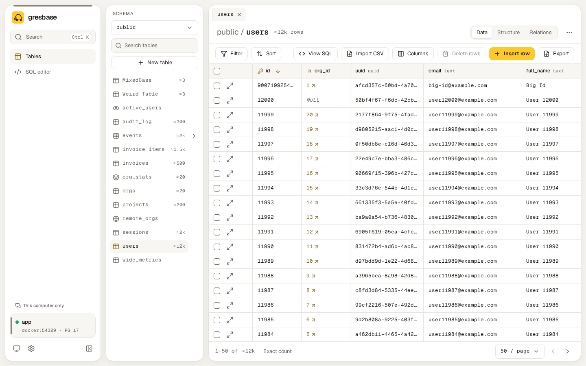
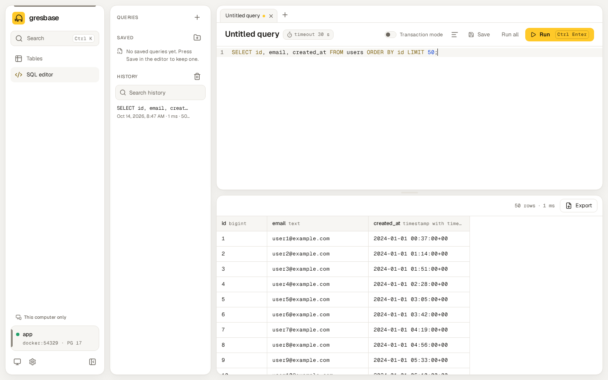

<p align="right"><b>English</b> · <a href="README.es.md">Español</a></p>

<div align="center">

<picture>
  <source media="(prefers-color-scheme: dark)" srcset="assets/brand/logo-dark.svg">
  
</picture>

<h1>gresbase</h1>

<p><b>A modern, self-hosted studio for any PostgreSQL. One container, zero config.</b></p>

<p>
  <a href="LICENSE"></a>
  <a href="https://github.com/amtzespinosa/gresbase/releases"></a>
  <a href="https://github.com/amtzespinosa/gresbase/actions/workflows/ci.yml"></a>
  <a href="#compatibility"></a>
  <a href="https://github.com/amtzespinosa/gresbase/pkgs/container/gresbase"></a>
  <a href="go.mod"></a>
</p>

<p>
  <a href="https://gresbase.pages.dev/docs/introduction/">Docs</a> ·
  <a href="#quick-start">Quick start</a> ·
  <a href="#try-the-demo">Demo</a> ·
  <a href="CHANGELOG.md">Changelog</a> ·
  <a href="README.es.md">Español</a>
</p>

<picture>
  <source media="(prefers-color-scheme: dark)" srcset=".github/assets/hero-dark.gif">
  
</picture>

</div>

## Contents

- [Why Gresbase](#why-gresbase)
- [Features](#features)
- [Quick start](#quick-start)
- [Screenshots](#screenshots)
- [How it compares](#how-it-compares)
- [Configuration](#configuration)
- [Security](#security)
- [Compatibility](#compatibility)
- [Roadmap](#roadmap)
- [Contributing](#contributing)
- [License](#license)

## Why Gresbase

Adminer and pgAdmin still do the job, but they look and feel like another decade, and an edit goes
straight to the database. Supabase Studio is a pleasure to use, but it comes with the Supabase stack.
Gresbase is one small container you add next to your Postgres: a fast, careful interface where every
change waits in a queue, shows its SQL, and can be undone even after you save it.

## Features

<table>
  <tr>
    <td width="50%"><b>Fast tables</b><br>Virtualized grid, keyset pagination, filters and multi-column sort kept in the URL.</td>
    <td width="50%"><b>Change queue</b><br>Edits wait with a diff and their SQL, then save in one transaction.</td>
  </tr>
  <tr>
    <td><b>Undo and redo</b><br>Even after saving, through inverse operations that check for conflicts.</td>
    <td><b>Structure editing</b><br>Tables, columns, indexes, constraints and foreign keys, previewing the exact DDL.</td>
  </tr>
  <tr>
    <td><b>SQL editor</b><br>Autocomplete, tabs, <code>:name</code> parameters, transaction mode, history and saved queries.</td>
    <td><b>Spreadsheet friendly</b><br>Copy a rectangle as TSV, CSV, JSON or <code>INSERT</code>; paste into the queue.</td>
  </tr>
  <tr>
    <td><b>Many connections</b><br>Saved connections with color labels; each browser tab can use a different one.</td>
    <td><b>Free mode</b><br>Sign in with any Postgres user and password, like Adminer, with an allowlist.</td>
  </tr>
  <tr>
    <td><b>Zero config</b><br>Environment variables or a setup wizard; settings in one file, secrets encrypted.</td>
    <td><b>Safe by default</b><br>Localhost only without login, read-only mode, timeouts, CSRF and rate limits.</td>
  </tr>
  <tr>
    <td><b>Import and export</b><br>CSV into existing tables; CSV and JSON exports that stream from the first byte.</td>
    <td><b>Small and private</b><br>One image, works offline, no telemetry; English and Spanish, light and dark.</td>
  </tr>
</table>

## Quick start

### Try the demo

PostgreSQL with sample data and Gresbase, using the published image. You only need Docker:

```bash
curl -fsSLO https://raw.githubusercontent.com/amtzespinosa/gresbase/main/deploy/docker-compose.demo.yml
docker compose -f docker-compose.demo.yml up -d
```

Open <http://localhost:8080>. The file also starts one instance per way of using Gresbase on ports
8081 to 8084 (login, read-only, setup wizard and free mode), described at the top of the file.
`docker compose -f docker-compose.demo.yml down -v` removes everything.

### Add it to your project

Put Gresbase next to your Postgres in your `docker-compose.yml`:

```yaml
services:
  gresbase:
    image: ghcr.io/amtzespinosa/gresbase:0.3
    restart: unless-stopped
    environment:
      DATABASE_URL: postgres://app:secret@db:5432/app?sslmode=disable
    ports:
      - "127.0.0.1:8080:8080"
    volumes:
      - gresbase-data:/data

volumes:
  gresbase-data:
```

```bash
docker compose up -d
```

Open <http://localhost:8080>. Without `DATABASE_URL`, Gresbase starts a setup wizard instead: the log
prints a link with its token, and `docker compose exec gresbase /gresbase setup-token` prints the token.
The [quick start guide](https://gresbase.pages.dev/docs/quick-start/) covers `docker run`, the wizard and
connecting to a database outside Docker. Binaries for Linux, macOS and Windows are attached to each
[release](https://github.com/amtzespinosa/gresbase/releases).

## Screenshots

<table>
  <tr>
    <td width="50%">
      <picture>
        <source media="(prefers-color-scheme: dark)" srcset="docs/screenshots/tables-desktop-dark.png">
        
      </picture>
      <p align="center"><sub>Tables</sub></p>
    </td>
    <td width="50%">
      <picture>
        <source media="(prefers-color-scheme: dark)" srcset="docs/screenshots/sql-desktop-dark.png">
        
      </picture>
      <p align="center"><sub>SQL editor</sub></p>
    </td>
  </tr>
  <tr>
    <td>
      <picture>
        <source media="(prefers-color-scheme: dark)" srcset="docs/screenshots/structure-desktop-dark.png">
        
      </picture>
      <p align="center"><sub>Structure</sub></p>
    </td>
    <td>
      <picture>
        <source media="(prefers-color-scheme: dark)" srcset="docs/screenshots/setup-desktop-dark.png">
        
      </picture>
      <p align="center"><sub>Setup wizard</sub></p>
    </td>
  </tr>
</table>

More screens, on desktop and tablet, in [`docs/screenshots/`](docs/screenshots/).

## How it compares

Every tool here is good at something. This is how they differ for the job Gresbase does: a web UI
next to your own Postgres.

| | Gresbase | Adminer | pgAdmin | Supabase Studio | DbGate |
| --- | --- | --- | --- | --- | --- |
| Self-hosted web UI | Yes | Yes | Yes (also desktop) | With the Supabase stack | Yes (also desktop) |
| One container, nothing else | Yes | Yes | Yes | No | Yes |
| Databases | PostgreSQL | Many | PostgreSQL | PostgreSQL | Many, SQL and NoSQL |
| Edits wait until you save | Yes, with diff and SQL | No | Yes | No | Yes |
| Undo after saving | Yes | No | No | No | No |
| Structure editing | Yes | Yes | Yes | Yes | Yes |
| Server administration (roles, backups, monitoring) | Not yet | Partial | Yes | Platform features | Partial |
| License | Apache-2.0 | Apache-2.0 or GPL-2.0 | PostgreSQL | Apache-2.0 | GPL-3.0 |

Pick pgAdmin for deep server administration, Adminer or DbGate when you work with several database
engines, and Supabase Studio if you run Supabase.

## Configuration

Every setting is optional. The ones you are most likely to use:

| Variable | What it does |
| --- | --- |
| `DATABASE_URL` | The database to open. Without it, the setup wizard or saved connections. |
| `GRESBASE_USER` / `GRESBASE_PASSWORD` | Turn on sign-in. Without an account, only `localhost` is accepted. |
| `GRESBASE_READ_ONLY` | `true` blocks every write. |
| `GRESBASE_MODE_FREE` | `true` signs in with Postgres credentials, like Adminer. |
| `GRESBASE_ALLOWED_DB_HOSTS` | Servers free mode may reach (hosts, IPs or CIDRs). |
| `GRESBASE_ALLOWED_HOSTS` | Extra host names accepted without sign-in. |
| `GRESBASE_TRUSTED_PROXIES` | Reverse proxies whose `X-Forwarded-For` gives the client IP. |
| `GRESBASE_BASE_PATH` | Serve under a sub-path, such as `/gresbase`. |
| `GRESBASE_STATEMENT_TIMEOUT` | Time limit per query (`30s` by default). |
| `GRESBASE_DATA_DIR` | Settings and saved queries (`/data`); mount a volume there. |

Settings changed in the app are kept in `gresbase.json`, and an environment variable always wins over
it. All variables, ports and limits are in the
[configuration reference](https://gresbase.pages.dev/docs/configuration-reference/).

## Security

- Without an account, Gresbase only answers requests for `localhost`, against accidental exposure and
  DNS rebinding.
- Passwords are stored as argon2id hashes, secrets in `gresbase.json` are encrypted, and logs never
  contain credentials.
- Sessions use `SameSite=Strict` cookies and a CSRF header; failed sign-ins are rate limited.
- Read-only mode is enforced twice: by the database session and by the API.
- Every query has a timeout. Long queries stay alive behind Nginx or Cloudflare without raising any
  proxy timeout.
- The real boundary is the Postgres role you connect with: give it only the privileges you want.

Reverse proxies, HTTPS and the setup token are covered in
[Security and networking](https://gresbase.pages.dev/docs/security/).

## Compatibility

| PostgreSQL | Support |
| --- | --- |
| 14, 15, 16, 17, 18 | Full, tested on every change |
| 19 | Full, tested against the latest beta until it is released |
| 12, 13 | Legacy: tested on every change; a few features depend on the version and the UI says so |
| 11 and older | Not supported; Gresbase explains it when connecting |

The image runs on `linux/amd64` and `linux/arm64`. Details per version in
[`docs/compatibility.md`](docs/compatibility.md) (in Spanish).

## Roadmap

- **Global search:** find a value in every table, with progress and results grouped by table.
- **Studio edition (0.4):** advanced mode, visual schema, metrics and a visual `EXPLAIN`.
- **Administration (0.5):** roles, extensions, views, functions, triggers, RLS and backups.
- **Teams (0.6):** multiple users with roles, permissions per connection, SSO and an audit log.

The full plan is in [`docs/spec.md`](docs/spec.md) (in Spanish).

## Contributing

Issues and pull requests are welcome. Start with [`CONTRIBUTING.md`](CONTRIBUTING.md); the stack,
the security rules and the conventions are in [`AGENTS.md`](AGENTS.md), for people and coding agents
alike. You only need Docker and git: every toolchain runs in the development container.

```bash
docker compose -f dev.compose.yml up -d --build
docker compose -f dev.compose.yml exec workspace bash -lc "task dev"
```

## License

Gresbase is licensed under the [Apache License 2.0](LICENSE). Copyright 2026 Alex M. Espinosa; see
[`NOTICE`](NOTICE). The Gresbase name and the mammoth logo are not covered by the license: forks use
another name and logo, as explained in [`TRADEMARKS.md`](TRADEMARKS.md). Third-party licenses are listed
in [`docs/third-party-licenses.md`](docs/third-party-licenses.md).
