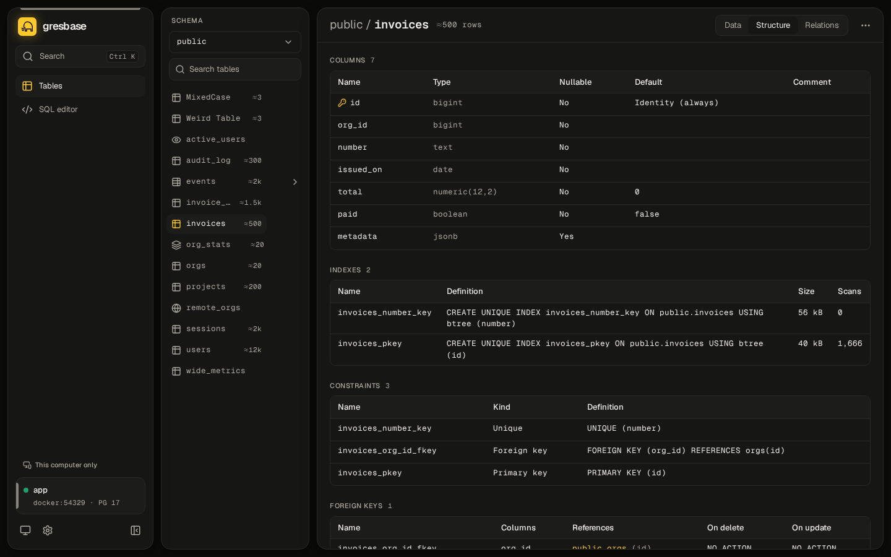

<p align="right"><b>English</b> · <a href="README.es.md">Español</a></p>

<div align="center">


<h1>gresbase</h1>

<p><b>A modern, self-hosted studio for any PostgreSQL. One container, zero config.</b></p>

<p>
  <a href="LICENSE"></a>
  <a href="https://github.com/amtzespinosa/gresbase/releases"></a>
  <a href="https://github.com/amtzespinosa/gresbase/actions/workflows/ci.yml"></a>
  <a href="#compatibility"></a>
  <a href="https://github.com/amtzespinosa/gresbase/pkgs/container/gresbase"></a>
  <a href="go.mod"></a>
</p>

<p>
  <a href="https://gresbase.pages.dev/docs/introduction/">Docs</a> ·
  <a href="#quick-start">Quick start</a> ·
  <a href="#try-the-demo">Demo</a> ·
  <a href="CHANGELOG.md">Changelog</a> ·
  <a href="README.es.md">Español</a>
</p>

<picture>
  <source media="(prefers-color-scheme: dark)" srcset=".github/assets/hero-dark.gif">
  
</picture>

</div>

## Contents

- [Why Gresbase](#why-gresbase)
- [Features](#features)
- [Quick start](#quick-start)
  - [Try the demo](#try-the-demo)
  - [Add it to your project](#add-it-to-your-project)
  - [No configuration: the setup wizard](#no-configuration-the-setup-wizard)
- [Screenshots](#screenshots)
- [How it compares](#how-it-compares)
- [Configuration](#configuration)
  - [Main variables](#main-variables)
  - [Settings file](#settings-file)
- [Security](#security)
- [Compatibility](#compatibility)
- [Roadmap](#roadmap)
- [Contributing](#contributing)
- [License](#license)

## Why Gresbase

Adminer and pgAdmin still do the job, but they **feel like another decade**, and an edit goes straight
to the database. Supabase Studio is a pleasure to use, but it **comes with the Supabase stack**.

Gresbase is **one small container** you add next to your Postgres. Every change **waits in a queue**,
shows its SQL, and can be undone even after you save it.

<div align="right"><a href="#readme">↑ Back to top</a></div>

## Features

<table>
  <tr>
    <td width="50%"><b>Fast tables</b><br>Virtualized grid, <b>keyset pagination</b>, filters and multi-column sort kept in the URL.</td>
    <td width="50%"><b>Change queue</b><br>Edits wait with a diff and their SQL, then save in <b>one transaction</b>.</td>
  </tr>
  <tr>
    <td><b>Undo and redo</b><br><b>Even after saving</b>, through inverse operations that check for conflicts.</td>
    <td><b>Structure editing</b><br>Tables, columns, indexes, constraints and foreign keys, previewing <b>the exact DDL</b>.</td>
  </tr>
  <tr>
    <td><b>SQL editor</b><br><b>Autocomplete</b>, tabs, <code>:name</code> parameters, transaction mode, history and saved queries.</td>
    <td><b>Spreadsheet friendly</b><br>Copy a rectangle as TSV, CSV, JSON or <code>INSERT</code>; <b>paste into the queue</b>.</td>
  </tr>
  <tr>
    <td><b>Many connections</b><br>Saved connections with color labels; <b>each browser tab</b> can use a different one.</td>
    <td><b>Free mode</b><br>Sign in with <b>any Postgres user</b>, like Adminer, limited to the servers you allow.</td>
  </tr>
  <tr>
    <td><b>Zero config</b><br>Environment variables or <b>a setup wizard</b>; settings in one file, secrets encrypted.</td>
    <td><b>Safe by default</b><br><b>Localhost only</b> without login, read-only mode, timeouts, CSRF and rate limits.</td>
  </tr>
  <tr>
    <td><b>Search all tables</b><br>A value in <b>every table</b> and names of tables and columns, streamed table by table.</td>
    <td><b>Read-only and roles</b><br>Searches and screens respect <b>the Postgres role</b>: its privileges and row security.</td>
  </tr>
  <tr>
    <td><b>Import and export</b><br>CSV into existing tables; exports that <b>stream from the first byte</b>.</td>
    <td><b>Small and private</b><br>One image, works offline, <b>no telemetry</b>; English and Spanish, light and dark.</td>
  </tr>
</table>

<div align="right"><a href="#readme">↑ Back to top</a></div>

## Quick start

### Try the demo

PostgreSQL with sample data and Gresbase, using the published image. **You only need Docker:**

```bash
curl -fsSLO https://raw.githubusercontent.com/amtzespinosa/gresbase/main/deploy/docker-compose.demo.yml
docker compose -f docker-compose.demo.yml up -d
```

Open **<http://localhost:8080>**. Ports 8081 to 8084 run the other ways of using Gresbase: login,
read-only, setup wizard and free mode, described at the top of the file.

To remove everything: `docker compose -f docker-compose.demo.yml down -v`.

### Add it to your project

Put Gresbase **next to your Postgres** in your `docker-compose.yml`:

```yaml
services:
  gresbase:
    image: ghcr.io/amtzespinosa/gresbase:0.4
    restart: unless-stopped
    environment:
      DATABASE_URL: postgres://app:secret@db:5432/app?sslmode=disable
    ports:
      - "127.0.0.1:8080:8080"
    volumes:
      - gresbase-data:/data

volumes:
  gresbase-data:
```

```bash
docker compose up -d
```

Then open <http://localhost:8080>. Binaries for **Linux, macOS and Windows** are attached to each
[release](https://github.com/amtzespinosa/gresbase/releases).

### No configuration: the setup wizard

Leave out `DATABASE_URL` and Gresbase **starts a setup wizard**. The log prints a link with its token,
or print the token with:

```bash
docker compose exec gresbase /gresbase setup-token
```

The [quick start guide](https://gresbase.pages.dev/docs/quick-start/) covers `docker run`, the wizard
and **databases outside Docker**.

<div align="right"><a href="#readme">↑ Back to top</a></div>

## Screenshots

<table>
  <tr>
    <td width="50%">
      
      <p align="center"><sub>Tables · light</sub></p>
    </td>
    <td width="50%">
      
      <p align="center"><sub>SQL editor · dark</sub></p>
    </td>
  </tr>
  <tr>
    <td width="50%">
      
      <p align="center"><sub>Structure · dark</sub></p>
    </td>
    <td width="50%">
      
      <p align="center"><sub>Setup wizard · light</sub></p>
    </td>
  </tr>
</table>

More screens, on desktop and tablet, in [`docs/screenshots/`](docs/screenshots/).

<div align="right"><a href="#readme">↑ Back to top</a></div>

## How it compares

Every tool here is good at something. This is how they differ **for the job Gresbase does**: a web UI
next to your own Postgres.

| | Gresbase | Adminer | pgAdmin | Supabase Studio | DbGate |
| --- | --- | --- | --- | --- | --- |
| Self-hosted web UI | Yes | Yes | Yes (also desktop) | With the Supabase stack | Yes (also desktop) |
| One container, nothing else | Yes | Yes | Yes | No | Yes |
| Databases | PostgreSQL | Many | PostgreSQL | PostgreSQL | Many, SQL and NoSQL |
| Edits wait until you save | Yes, with diff and SQL | No | Yes | No | Yes |
| Undo after saving | Yes | No | No | No | No |
| Structure editing | Yes | Yes | Yes | Yes | Yes |
| Server administration (roles, backups, monitoring) | Not yet | Partial | Yes | Platform features | Partial |
| License | Apache-2.0 | Apache-2.0 or GPL-2.0 | PostgreSQL | Apache-2.0 | GPL-3.0 |

Pick **pgAdmin** for deep server administration, **Adminer or DbGate** when you work with several
database engines, and **Supabase Studio** if you run Supabase.

<div align="right"><a href="#readme">↑ Back to top</a></div>

## Configuration

**Every setting is optional.** Use environment variables, or change settings from the app.

### Main variables

| Variable | What it does |
| --- | --- |
| `DATABASE_URL` | The database to open. Without it, the setup wizard or saved connections. |
| `GRESBASE_USER` / `GRESBASE_PASSWORD` | Turn on sign-in. Without an account, only `localhost` is accepted. |
| `GRESBASE_READ_ONLY` | `true` blocks every write. |
| `GRESBASE_MODE_FREE` | `true` signs in with Postgres credentials, like Adminer. |
| `GRESBASE_ALLOWED_DB_HOSTS` | Servers free mode may reach (hosts, IPs or CIDRs). |
| `GRESBASE_ALLOWED_HOSTS` | Extra host names accepted without sign-in. |
| `GRESBASE_TRUSTED_PROXIES` | Reverse proxies whose `X-Forwarded-For` gives the client IP. |
| `GRESBASE_BASE_PATH` | Serve under a sub-path, such as `/gresbase`. |
| `GRESBASE_STATEMENT_TIMEOUT` | Time limit per query (`30s` by default). |
| `GRESBASE_DATA_DIR` | Settings and saved queries (`/data`); mount a volume there. |

### Settings file

Settings changed in the app are kept in `gresbase.json`, and **an environment variable always wins**
over it. Secrets in that file are encrypted.

All variables, ports and limits are in the
[configuration reference](https://gresbase.pages.dev/docs/configuration-reference/).

<div align="right"><a href="#readme">↑ Back to top</a></div>

## Security

- Without an account, Gresbase **only answers requests for `localhost`**, against accidental exposure
  and DNS rebinding.
- Passwords are stored as **argon2id hashes**, secrets in `gresbase.json` are encrypted, and logs never
  contain credentials.
- Sessions use `SameSite=Strict` cookies and a CSRF header; **failed sign-ins are rate limited**.
- Read-only mode is **enforced twice**: by the database session and by the API.
- Every query has a timeout, and long queries **stay alive behind Nginx or Cloudflare**.
- The real boundary is **the Postgres role you connect with**: give it only the privileges you want.

Reverse proxies, HTTPS and the setup token are covered in
[Security and networking](https://gresbase.pages.dev/docs/security/).

<div align="right"><a href="#readme">↑ Back to top</a></div>

## Compatibility

| PostgreSQL | Support |
| --- | --- |
| 14, 15, 16, 17, 18 | Full, tested on every change |
| 19 | Full, tested against the latest beta until it is released |
| 12, 13 | Legacy: tested on every change; a few features depend on the version and the UI says so |
| 11 and older | Not supported; Gresbase explains it when connecting |

The image runs on **`linux/amd64` and `linux/arm64`**. Details per version in
[`docs/compatibility.md`](docs/compatibility.md) (in Spanish).

<div align="right"><a href="#readme">↑ Back to top</a></div>

## Roadmap

- **Studio edition (0.5):** advanced mode, visual schema, metrics and a visual `EXPLAIN`.
- **Administration (0.6):** roles, extensions, views, functions, triggers, RLS and backups.
- **Teams (0.7):** multiple users with roles, permissions per connection, SSO and an audit log.

The full plan is in [`docs/spec.md`](docs/spec.md) (in Spanish).

<div align="right"><a href="#readme">↑ Back to top</a></div>

## Contributing

**Issues and pull requests are welcome.** Start with [`CONTRIBUTING.md`](CONTRIBUTING.md); the stack,
the security rules and the conventions are in [`AGENTS.md`](AGENTS.md), for people and coding agents
alike.

You **only need Docker and git**: every toolchain runs in the development container.

```bash
docker compose -f dev.compose.yml up -d --build
docker compose -f dev.compose.yml exec workspace bash -lc "task dev"
```

<div align="right"><a href="#readme">↑ Back to top</a></div>

## License

Gresbase is licensed under the **[Apache License 2.0](LICENSE)**. Copyright 2026 Alex M. Espinosa; see
[`NOTICE`](NOTICE).

The **Gresbase name and the mammoth logo** are not covered by the license: forks use another name and
logo, as explained in [`TRADEMARKS.md`](TRADEMARKS.md). Third-party licenses are listed in
[`docs/third-party-licenses.md`](docs/third-party-licenses.md).

<div align="right"><a href="#readme">↑ Back to top</a></div>
